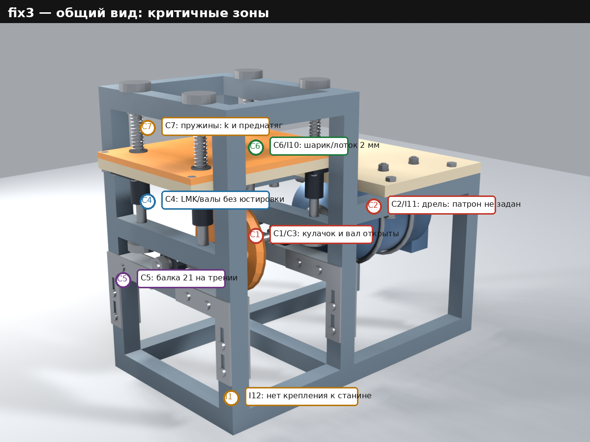
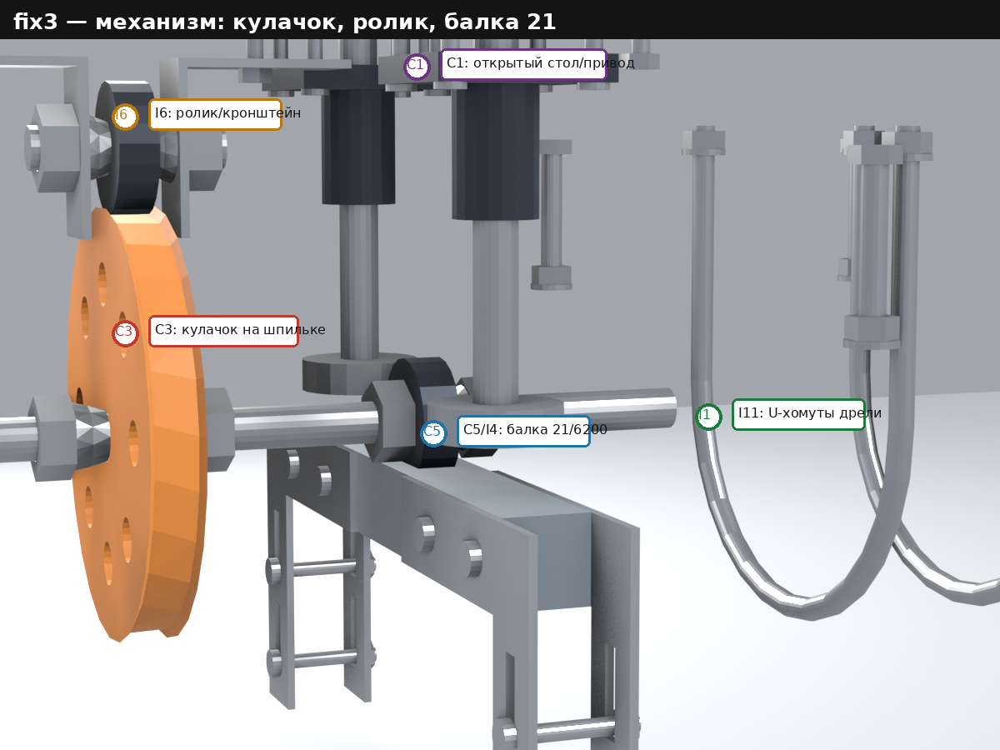
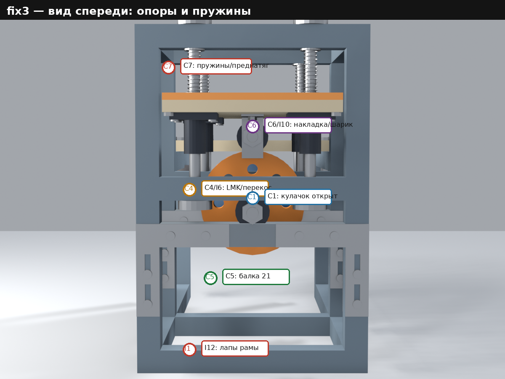

# Отчёт по этапу «Инженерная экспертиза»

Дата: 2026-10-30
Этап: `stages/expert`
Объект: модель [`stages/fix3`](../fix3/README.md) (рама 360×200×300, 28 позиций)
Инструменты: Python 3.10 (`cad/analysis.py`), Pillow, Inkscape; исходные данные
fix3 (`params.csv`, `mass.csv`, `spec.csv`, `checks.csv`, STEP/STL, рендеры).
Модель fix3 **не изменялась**.

## 1. Результат

| Результат | Файлы |
|---|---|
| Отчёт | `Report.md` (этот файл) |
| Вопросы, допущения, что не проверялось | [`Interview.md`](./Interview.md) |
| Реестр 33 замечаний (7 / 18 / 8) | [`findings.csv`](./findings.csv) |
| Числовые проверки экспертизы (33) | [`cad/calc.csv`](./cad/calc.csv) |
| Карта режимов «частота × размах» (33) | [`cad/map.csv`](./cad/map.csv) |
| Воспроизводимый расчёт | [`cad/analysis.py`](./cad/analysis.py) |
| Листы: карта режимов, пружины/контакт, кинематика, силовой путь, допуски | [`fig/`](./fig/) — `operating_map.svg`, `spring_contact.svg`, `kinematics.svg`, `load_path.svg`, `tolerance_stack.svg` |
| Сводный лист A3 | [`fig/expert_sheet.svg`](./fig/expert_sheet.svg), превью [`pic/expert_sheet_preview.png`](./pic/expert_sheet_preview.png) |
| Размеченные рендеры | [`pic/review_iso.png`](./pic/review_iso.png), [`pic/review_mechanism.png`](./pic/review_mechanism.png), [`pic/review_front.png`](./pic/review_front.png) |
| Превью листов | [`pic/operating_map_preview.png`](./pic/operating_map_preview.png), `spring_contact_preview.png`, `kinematics_preview.png`, `load_path_preview.png`, `tolerance_stack_preview.png` |
| Задание следующего этапа | [`../fix4/README.md`](../fix4/README.md) |

## 2. Постановка, границы и терминология

Экспертиза — **аналитическая**: проверены геометрия, кинематика, статика,
динамика в первом приближении, прочность/жёсткость, допуски, технологичность
и эксплуатационные риски. Пространственные (FEA), усталостные, модальные и
трибологические расчёты не выполнялись; для них в отчёте указаны оценки и
места, требующие испытаний.

**Терминология.** В модели fix3 слово «ход» означает **размах**
(peak-to-peak): ход 3/5/10 мм — это полный ход стола. В формуле ускорения
`a = A·ω²` амплитуда `A` равна половине размаха. В корневом README написано
«амплитуда 3…10 мм» без определения; это неоднозначность, от которой зависит
выполнение обязательного требования (см. C6 и вопрос В1 в
[`Interview.md`](./Interview.md)).

**Допущения** (подробно — в `Interview.md`):

- пружина 12×1,0, средний диаметр 11 мм, 11 активных витков, сталь;
- реальные массы покупных LMK10UU ≈45 г, 6200 ≈15 г;
- PLA: E≈3,5 ГПа, ν≈0,35; PETG: E≈2,0 ГПа; сталь: E=200 ГПа;
- движущаяся масса стола ≈0,92 кг (расчёт ниже);
- профиль кулачка — эксцентриковая окружность (как в модели);
- дрель — заглушка Ø100, X=210…340; патрон/рукоятка не смоделированы.

Все числа — в [`cad/calc.csv`](./cad/calc.csv) (33 проверки: 6 OK,
8 WARN, 14 FAIL, 5 INFO) и [`cad/map.csv`](./cad/map.csv). FAIL в `calc.csv`
не равен «критичному»: часть FAIL — точность, документация и отсутствие
исходных данных; критичность определена отдельно в [`findings.csv`](./findings.csv).

## 3. Модель в цифрах

| Узел | Значение (fix3) |
|---|---|
| Рама | PETG, одним куском, 360×200×300, сплошное 20×20, 1,87 кг |
| Виброотсек / вынос | 160 / 200 мм |
| Стол / накладка | 200×150×10 / 200×150×6, PLA; вогнутость Ø140×2 |
| Направляющие | 4×Ø10, L=166, X=10/150, Y=50/150; LMK10UU (4) |
| Пружины | 4×Ø12×1,0, L0≈55, установленная 36 мм; **k не задана** |
| Вал привода | шпилька M10, X=−10…215; 6200 в X=10 и 150 |
| Кулачок | X=74…86; эксцентрик, диски 3/5/10 мм; ролик 6200, Z=205 |
| Балки 21 | 2×20×20×159,6, Z=110…130; 8 накладок 2 мм; ход вниз 15 мм |
| Подстолье | PETG 160×200×12, X=200…360; 4×M6×45 |
| Дрель | заглушка Ø100, X=210…340; U-хомуты X=250/300 |
| Масса без дрели | 5,49 кг по `mass.csv`; ≈5,12 кг с реальными LMK/6200 |
| Движущаяся масса | 0,92 кг (реальная) / 1,22 кг (по `mass.csv`) |

Модель геометрически целостна (143 из 144 проверок fix3 — OK; единственное
предупреждение — посадка пружины ID 10,2 при вале Ø10). Ниже — то, что
геометрические проверки не ловят: динамика, точность, затяжка, допуски,
безопасность и границы применимости.

## 4. Главный вывод

**Модель нельзя передавать в эксплуатацию в текущем виде.** Семь замечаний
критичны: нет ограждения вращающихся частей; привод «дрель–вал» не определён
(конец вала X=215 попадает внутрь условного корпуса дрели); осевая фиксация
кулачка/6200 на шпильке без буртиков; направляющие валы не имеют юстировки;
балка 21 — единственная нижняя опора 6200 — держится только трением; не весь
диапазон 5…15 Гц × 3…10 мм даёт отрыв шарика; жёсткость и преднатяг пружин не
заданы.

Восемнадцать важных замечаний ухудшают точность, ресурс, ремонтопригодность
и удобство (смена амплитуды, PETG-карманы, валы без твёрдости, накладка без
удержания шарика, крепление дрели и рамы, документы). Восемь пожеланий не
несут прямых рисков, но не позволяют приблизиться к целям README
(минимум точек трения, линейная связь частоты/амплитуды с геометрией,
покупные детали).

Порядок исправлений — в [`../fix4/README.md`](../fix4/README.md): сначала
C1–C7, затем I1–I18, пожелания — после. **До выбора дрели и определения
«амплитуды» (размах или нуль-пик) моделирование fix4 начинать нельзя** — от
этого зависят длина вала, патрон, крепление и комплект дисков.

## 5. Критичные замечания

### C1. Нет ограждения вращающихся частей и аварийного останова

- **Суть.** Кулачок Ø90…110, вал, гайки и патрон дрели открыты на уровне
  Z=95…195; частота 5…15 Гц соответствует 300…900 об/мин. Ограждения,
  блокировки и E-stop нет.
- **Последствие.** Захват рукава/волос, порез о кулачок и гайки, удар
  вылетевшей деталью; риск серьёзной травмы. Это критично независимо от
  качества расчётов.
- **Корректировка.** Съёмное ограждение из прозрачного поликарбоната или
  сетки вокруг кулачка, вала, гаек и патрона; дверца с блокировкой; E-stop;
  маркировка опасной зоны. Ограждение не должно касаться стола и пружин.
- **Приёмка.** Зазор ≥10 мм от подвижных частей; доступ к кулачку только
  через блокированную дверцу; проверка на 900 об/мин; E-stop разрывает
  питание дрели.

### C2. Привод «дрель–вал» не определён; вал упирается в корпус дрели

- **Суть.** Вал — шпилька M10, X=−10…215. Условный корпус дрели —
  X=210…340. Конец вала X=215 находится **на 5 мм внутри корпуса**; патрон,
  кулачки и рукоятка не смоделированы. Гладкого хвостовика Ø10, фланца,
  гибкой муфты и осевого упора нет. Вал зажат между патроном и гайками 6200,
  то есть осевое положение задаётся двумя источниками одновременно.
- **Последствие.** Вал не гарантированно входит в патрон; при сборке
  придётся либо укорачивать вал, либо сдвигать дрель. Резьба M10 — плохая
  поверхность для кулачков патрона; биение и осевая перегрузка подшипников;
  возможен проворот/выдёргивание вала из патрона на 900 об/мин.
- **Корректировка.** Выбрать реальную дрель, смоделировать патрон и
  рукоятку; выполнить хвостовик Ø10 h6 с лыской или квадратом; поставить
  гибкую муфту (или квадратный привод) и осевой упор; согласовать длину вала
  с патроном; проверить биение.
- **Приёмка.** Хвостовик в патроне ≥20 мм; биение ≤0,05 мм; осевой люфт
  ≤0,2 мм; муфта допускает радиальное/угловое смещение; вал не упирается в
  корпус; после 1 ч на 900 об/мин осевое смещение ≤0,1 мм.

### C3. Осевая фиксация кулачка и 6200 на шпильке без буртиков

- **Суть.** Кулачок 74…86 зажат конусными гайками 66…74 и 86…94 и
  контргайками. Конус гайки (20°) упирается в фаску кулачка 1×45°; площадь
  кольца контакта ≈31 мм²; кулачок — PLA. Шпилька M10 не имеет буртика;
  осевой люфт наружного кольца 6200 в карманах 0,2 мм. Ложбинка кулачка —
  2 мм, ширина 9,5, ролик 9 мм.
- **Последствие.** Пластик под конусной гайкой сминается/ползёт, затяжка
  падает, кулачок смещается по оси. При смещении >0,5 мм ролик выходит из
  ложбинки; стол теряет опору и падает, ролик/кронштейн бьёт по кулачку.
  На 900 об/мин это ещё и риск вылета кулачка.
- **Корректировка.** Ступенчатый вал с буртиками/поясами под 6200;
  шпонка или лыска для кулачка; стальные упорные шайбы или стальная втулка в
  кулачке; ответный конус 45° или плоская шайба; положительный осевой упор;
  фиксация резьбы.
- **Приёмка.** Осевое смещение кулачка ≤0,1 мм; радиальное биение ≤0,05 мм;
  кулачок не проворачивается при 2× номинальном моменте; контроль после 1 ч
  работы.

### C4. Направляющие валы не имеют юстировки параллельности

- **Суть.** 4 LMK10UU на валах Ø10 стоят в печатных отверстиях Ø10,5
  (зазор 0,5 мм) длиной 20 мм. Вал может наклоняться в пределах зазора:
  `atan(0,5/20)=1,43°`; на базе 110 мм между верхней и средней поперечинами
  это даёт **2,75 мм**. Кольцевые ограничители фиксируют вал по оси, но не
  задают угол. LMK10UU требует параллельности порядка 0,02…0,05 мм.
- **Последствие.** Заклинивание стола, повышенный износ шариков LMK,
  непостоянное трение и перекос стола; при сборке «как получится» устройство
  может не двигаться вовсе.
- **Корректировка.** Отдельные регулируемые опоры валов (сухари с пазами и
  шайбами) или расточка H7 и шлифованные валы с буртиками; юстировка по
  индикатору; рассмотреть 2 вала/4 втулки или самоустанавливающиеся втулки.
- **Приёмка.** Параллельность ≤0,02 мм на 100 мм; стол перемещается без
  закусывания на всём ходе; усилие страгивания ≤20 Н; проверка индикатором.

### C5. Балка 21 — нижняя опора 6200 — держится только трением

- **Суть.** Две балки 21 — единственная нижняя опора двух 6200. Каждая
  держится 8 прижимными M4 через PETG-стойки и 8 M4 через PETG-балку;
  положительного упора, шпонки или страховочной скобы нет. Нагрузка на опору
  (реакция кулачка) — 25…90 Н, плюс вибрация.
- **Последствие.** При ослаблении болтов или фреттинге в PETG балка
  сползает вниз; наружное кольцо 6200 выпадает из кармана; вал/кулачок
  проседает; вращающийся кулачок бьёт по ролику/кронштейну. Это отказ
  безопасности, а не только потеря точности.
- **Корректировка.** Положительный упор (буртик/шпонка/стальной кронштейн)
  под балкой 21; домкратный винт/клин для регулировки; страховочная скоба под
  6200; контроль момента; замена трения на зацепление.
- **Приёмка.** Балка выдерживает 3× статическую нагрузку без смещения; после
  1 ч вибрации 15 Гц смещение ≤0,05 мм; 6200 не выпадает при ослаблении
  одного болта.

### C6. Не весь диапазон 5…15 Гц × 3…10 мм даёт отрыв шарика

- **Суть.** Шарик отрывается от стола, когда ускорение стола вниз превышает
  `g`: `a_max = A·ω² = (s/2)·(2πf)² > g`, где `s` — размах. Пороги:

  | Размах s, мм | A=s/2, мм | f_thr, Гц | Шарик не отрывается |
  |---:|---:|---:|---|
  | 3 | 1,5 | 12,87 | 5…12,8 Гц |
  | 5 | 2,5 | 9,97 | 5…9,9 Гц |
  | 10 | 5,0 | 7,05 | 5…7,0 Гц |

  При 5 Гц и размахе 10 мм `a_max=4,93 м/с² < 9,81`; шарик не покидает
  стол. При 5…7 Гц **ни один** диск не даёт отрыва; диск 3 мм работает
  только выше 12,9 Гц, диск 5 мм — выше 10,0 Гц. Если в ТЗ «амплитуда» —
  нуль-пик, то пороги равны 9,1/7,05/4,98 Гц, а текущие диски 3/5/10 по
  размаху дают амплитуду 1,5/2,5/5 мм, то есть **не покрывают** требуемые
  3…10 мм.
- **Последствие.** На части обязательного диапазона эксперимент «время
  между соударениями» физически не воспроизводится: шарик лежит и колеблется
  вместе со столом.
- **Корректировка.** Уточнить определение амплитуды; опубликовать карту
  режимов; расширить комплект дисков (например, 10/15/20 мм размаха) или
  сузить частотный диапазон; предусмотреть удержание шарика; проверить с
  шариками 20 и 33 г.
- **Приёмка.** Для каждого режима эксперимента `a_max≥1,5g`; карта режимов
  в паспорте; шарик остаётся в лотке; время между ударами измеряется.

### C7. Жёсткость и преднатяг пружин не заданы

- **Суть.** В `spec.csv` указаны только Ø12×1,0, L0≈55 и установленная длина
  36 мм; жёсткость, число активных витков, материал и допуск L0 отсутствуют.
  Для типовой пружины 12×1,0 с D=11 и n=11:
  `k=G·d⁴/(8·D³·n)=0,68 Н/мм`, четыре пружины — 2,71 Н/мм, преднатяг при
  L=36 — 51,5 Н. Движущаяся масса ≈0,92 кг; на 15 Гц и размахе 10 мм
  инерционная сила 40,8 Н, сила пружины в верхней точке 65,0 Н, сила контакта
  ролика всего **24,2 Н** (0,59 от инерционной). При k=0,5 — 7 Н (0,17), при
  массе 1,2 кг и k=0,68 — 12 Н (0,22), при k=0,4 — отрицательная (отрыв).
  Собственная частота 8,6 Гц лежит внутри 5…15 Гц.

  | k, Н/мм | 4k, Н/мм | F0 (5 мм), Н | F пружины сверху (10 мм), Н | F инерции (15 Гц/10 мм), Н | F контакта, Н | Запас | f_соб, Гц |
  |---:|---:|---:|---:|---:|---:|---:|---:|
  | 0,68 | 2,71 | 51,5 | 65,0 | 40,8 | 24,2 | 0,59 | 8,6 |
  | 1,00 | 4,00 | 76,0 | 96,0 | 40,8 | 55,2 | 1,35 | 10,4 |
  | 1,30 | 5,21 | 98,8 | 124,8 | 40,8 | 84,0 | 2,06 | 11,9 |

- **Последствие.** При более мягкой пружине или меньшей L0 ролик отрывается
  от кулачка; стол падает и бьёт по кулачку, амплитуда и гармоничность
  теряются. Порог по свободной длине: для контакта на 15 Гц/10 мм нужно
  `L0≥46,1 мм`; при L0=45 мм (допуск −10 мм) контакт уже отрицательный.
  Спецификация этого не гарантирует.
- **Корректировка.** Задать k, L0, число витков, материал и допуск; выбрать
  k≥1,3 Н/мм (запас 2×) или 6…8 пружин; добавить регулировку преднатяга
  (шайбы/винты) и демпфирование; проверить отрыв ролика.
- **Приёмка.** Сила контакта ≥2× инерционной на всех режимах; преднатяг
  регулируется; после 1 ч работы амплитуда ±0,2 мм от заданной; контроль
  индикатором/датчиком.

## 6. Важные замечания

| ID | Замечание | Доказательство / последствие | Корректировка |
|---|---|---|---|
| I1 | Смена амплитуды требует разборки вала | Смена 3→10 мм: снять вал/кулачок, ослабить 8 прижимных болтов, опустить 2 балки на 15 мм; только 3 диска. Противоречит пожеланию «минимум точек регулировки». | Быстросъёмный кулачок на шпонке/фланце с одной гайкой; диски с общей базой; шкала; инструкция. |
| I2 | Корневой README противоречит модели | README: сварная сталь 20×20×1,5, стол вытянут по Y; модель: PETG 20×20 сплошной, стол 200×150 по X. | Обновить README или зафиксировать решение; один источник истины. |
| I3 | Шпилька M10 — посадочная поверхность 6200 | Резьба d3=8,16; прогиб 0,13 мм (2,6% хода 5 мм) при 100 Н; напряжение 65,6 МПа плюс концентратор; гладких поясов/буртиков нет. | Шлифованный ступенчатый вал Ø10/Ø12 с поясами h6 и буртиками. |
| I4 | 6200 в печатных PETG-карманах, балка 21 на 2 мм пластинах | Карманы R15×5, ширина 9,4, осевой зазор 0,2; слоистая поверхность; при износе люфт и стук; пластины 2 мм работают на изгиб в зоне пазов. | Стальные/расточенные вкладыши или заменяемые корпуса; осевой преднатяг 0,02…0,05; пластины 3 мм/стальной кронштейн. |
| I5 | Направляющие валы без твёрдости/шлифовки/допуска | Спецификация: «пруток, резка». LMK10UU требует h6 и HRC60; мягкий пруток быстро изнашивается, появляется люфт. | Покупные шлифованные валы Ø10 h6, HRC60; указать Ra и допуск. |
| I6 | Стол на 4 LMK в одной плоскости | 4 втулки 29 мм на базе 140×100; зазор LMK и одна плоскость дают перекос 0,05…0,1 мм на шарике; при непараллельности — закусывание. | Две втулки на вал/линейные каретки; увеличить базу; проверить перекос индикатором. |
| I7 | Нет регулировки преднатяга и высоты стола | Средняя высота стола 220+2e: 223/225/230 мм для дисков 3/5/10; разброс 7 мм; преднатяг и высота шарика меняются. | Общая база/максимальный радиус дисков; шайбы/винты преднатяга; шкала высоты. |
| I8 | Рама одним куском PETG без галтелей | 360×200×300, 1,87 кг, 100% заполнение; прямые внутренние углы; циклические нагрузки; трещина требует перепечатки всей рамы. | Галтели R3…5; разъёмная рама/заменяемые стальные кронштейны; циклические испытания. |
| I9 | Точность печати карманов и отверстий не обеспечена | Карманы R15 и отверстия Ø10,5 печатаются с поддержками; FDM ±0,2 мм; расточки/кондуктора нет. | Расточка/развёртывание по кондуктору; отдельные опоры/вкладыши; контроль координат и параллельности. |
| I10 | Накладка PLA, нет удержания шарика и ударной пластины | Вогнутость Ø140×2; шарик 20/33 г при 10 мм/15 Гц покидает лоток; PLA сминается, контактное время/отскок меняются. | Борт/прозрачное кольцо; сменная закалённая пластина 2 мм; глубже лоток; материал. |
| I11 | Крепление дрели не регулируется | U-хомут 100 мм, корпус-заглушка Ø100; рукоятка/курок/патрон не смоделированы; фактическая дрель может не поместиться/не зажаться. | Выбрать дрель; регулируемые хомуты/сменные седла; резиновая подкладка; при необходимости рёбра подстолья. |
| I12 | Нет элементов крепления рамы к станине | README требует струбцины, но в раме нет отверстий/площадок; лапы 20×20 PETG мнутся; при 15 Гц возможен уход. | 4×M6 в нижних балках + стальные/фанерные подкладки; резиновый коврик; схема крепления. |
| I13 | Гармоничность: вторая гармоника эксцентрика | Для эксцентрика с роликом вторая гармоника `e²/(2(R+r))` = 0,019/0,05/0,19 мм для хода 3/5/10 (0,6/1,0/1,9% размаха); идеальной синусоиды нет. | Принять допуск ≤2% или скорректировать профиль; проверить ход/ускорение. |
| I14 | Частота задаётся дрелью без тахометра | Ручка дрели не калибрована; частота зависит от нагрузки/сети; обратной связи нет; требуется 5…15 Гц. | Метка на валу + тахометр/стробоскоп; калибровка; при необходимости encoder/VFD. |
| I15 | Массовая модель и отчёт требуют уточнения | Пружина 2,4 г/шт. (модель верна), в отчёте fix3 — 40 г; LMK 115 г против 45 г, 6200 44 г против 15 г; движущаяся масса 0,92/1,22 кг; итог 5,12/5,49 кг. | Обновить `mass.csv` реальными массами; пересчитать динамику; исправить текст. |
| I16 | Опускание балки 21 без домкрата/упора | Нужно ослабить 8 болтов и вручную опустить две балки на 15 мм; фиксации от падения и плавного хода нет. | Домкратный винт/клин, направляющие, страховочный упор; процедура. |
| I17 | Кронштейн ролика — один M4 в пазу | Каждый из 2 кронштейнов 2 мм крепится одним потайным M4 в пазу 10×4,5; горизонтальная сила кулачка и вибрация; второго болта/шпонки нет; головка в 10 мм PLA. | Два M4 или M4 + шпонка/штифт; стальная шайба/вставка; упор по X. |
| I18 | Спецификация и отчёт расходятся с моделью | Поз. 10: R45…50 при диске 10 мм R45…55; поз. 14: 60×60 при 60×80; поз. 20: хвостовик Ø10 при резьбе M10; отчёт: пружина 40 г при 2,4 г; README: сталь при PETG (I2). | Обновить `spec.csv`, `params.csv`, отчёт и README; проверка согласованности. |

## 7. Пожелания

| ID | Пожелание | Почему |
|---|---|---|
| W1 | Сократить число движущихся частей и точек трения | 4 LMK, 3 6200, 4 пружины, 8 конусных гаек, 8 контргаек, 16 винтов фланцев, 8 прижимных болтов; пожелание README п.1. |
| W2 | Линейно выразить частоту и амплитуду через геометрию | Амплитуда — диск, частота — дрель; связи с геометрией нет; пожелание README п.6. |
| W3 | Модульная/гибридная рама вместо одной печатной детали | 1,87 кг одним куском; ремонт — перепечатка; пожелание «покупные детали». |
| W4 | Заменить бытовую дрель приводом с обратной связью | Дрейф оборотов, шум, вибрации подстолья; стабильность частоты. |
| W5 | Стандартные покупные опоры вместо печатных карманов | 6200 в PETG, балка 21 на 2 мм пластинах; пожелание «покупаемые детали». |
| W6 | Демпфирование стола/пружин | f_соб≈8,6 Гц внутри 5…15; резонансные силы/шум. |
| W7 | Инструментарий и протокол эксперимента | Нет шкалы амплитуды, тахометра, держателя микрофона, шаблона протокола. |
| W8 | Обслуживание и быстрая замена расходников | Кулачок/накладка/ударная пластина — расходники; доступ требует разборки; нет меток моментов и ЗИП. |

## 8. Числовые проверки

Полный список — [`cad/calc.csv`](./cad/calc.csv) (33 строки) и
[`cad/map.csv`](./cad/map.csv) (33 режима). Ключевые:

| Проверка | Значение | Норма / вывод |
|---|---|---|
| Движущаяся масса (реальная / по mass.csv) | 0,916 / 1,225 кг | для динамики — реальная; 1,22 — консервативная |
| Масса без дрели (модель / с реальными LMK/6200) | 5,49 / 5,12 кг | модель завышена на 0,37 кг |
| Пружина: k при 11 витках | 0,677 Н/мм | в спецификации не задана |
| Пружина: преднатяг / f_соб | 51,5 Н / 8,64 Гц | f_соб внутри 5…15; нужен расчёт/испытание |
| Контакт ролика, 15 Гц/10 мм | 24,2 Н при инерционной 40,8 Н | запас 0,59; при k=1,3 — 84,0 Н (2,06) |
| Минимальная L0 для контакта 15 Гц/10 мм | 46,1 мм | при L0≈55 запас есть; допуск не задан |
| Порог отрыва шарика (размах 3/5/10) | 12,87 / 9,97 / 7,05 Гц | при 5 Гц ни один диск не отрывает шарик |
| Ускорение 5 Гц / размах 10 мм | 4,93 м/с² | < 9,81 — отрыва нет |
| Прогиб вала M10 при 100 Н | 0,131 мм | 2,6% хода 5 мм; при k=1,3 нагрузка выше |
| Напряжение в резьбе вала при 100 Н | 65,6 МПа | плюс концентратор; запас усталости не проверен |
| Контакт кулачок–ролик (Герц) | p0≈34,7 МПа | PLA 50%; износ/усталость поверхности |
| Давление конусной гайки на PLA | 9,6 МПа при 300 Н | номинал OK; контакт по кольцу/линии, ползучесть |
| Перекос вала в Ø10,5 | 1,43°; 2,75 мм на 110 мм | LMK требует ~0,02…0,05 мм; юстировки нет |
| Вторая гармоника | 0,019/0,05/0,192 мм | 0,6/1,0/1,9% размаха; допуск ≤2% |
| Средняя высота стола по дискам | 223/225/230 мм | разброс 7 мм; преднатяг меняется |
| Прогиб подстолья от веса дрели | 0,014 мм | статически мало; опасны зажимные усилия |
| Оценка частоты рамы | ≈19,6 Гц | близко к 15 Гц; нужен модальный тест |
| Конец вала / корпус дрели | 215 / 210…340 мм | конец внутри корпуса; патрон не смоделирован |
| Крепление рамы / удержание шарика | 0 отверстий / борта нет | критично для эксплуатации |
| Твёрдость валов / крепление кронштейна | не заданы / 1×M4 | h6, HRC60 / ≥2 M4 |
| Согласованность spec/README | 4 расхождения | обновить документы |

**Проверка масс.** Модель `mass.csv` даёт 5,49 кг; реальные LMK10UU (4×45 г)
и 6200 (2+1 по 15 г) уменьшают итог на ≈0,37 кг — до ≈5,12 кг. Масса пружины
в модели 2,4 г/шт. (оболочка) **верна** для 12×1,0; утверждение отчёта fix3
«≈10 г вместо ≈40 г» не подтверждается и требует исправления. Движущаяся
масса: 0,916 кг с реальными LMK/6200 (стол 363 г, накладка 200 г, LMK 180 г,
кронштейн 46 г, ролик 15 г, ось/гайки 55 г, крепёж 17 г, шайбы 8 г, шарик
33 г); 1,225 кг по `mass.csv` (LMK/6200 — сплошные).

**Проверка шарика.** Карта режимов — [`fig/operating_map.svg`](./fig/operating_map.svg)
и [`pic/operating_map_preview.png`](./pic/operating_map_preview.png). Красная
область — режимы, где шарик не отрывается; горизонтальные линии — диски
3/5/10; точки — пороги. При 5 Гц и размахе 10 мм ускорение 4,93 м/с², то есть
вдвое меньше g; при 5…7 Гц отрыва нет ни на одном диске.

**Проверка пружин.** [`fig/spring_contact.svg`](./fig/spring_contact.svg):
слева — сила пружин от перемещения для k=0,68/1,0/1,3; справа — сила контакта
при 15 Гц для дисков 3/5/10. При k=0,68 и 10 мм сила контакта 24 Н (0,59 от
инерционной); при k=1,3 — 84 Н (2,06). Спецификация должна задать k и L0;
допуск L0 −10 мм уже даёт отрыв.

**Проверка вала.** [`fig/load_path.svg`](./fig/load_path.svg) и
[`fig/tolerance_stack.svg`](./fig/tolerance_stack.svg): прогиб 0,13 мм при
100 Н, напряжение 65,6 МПа, перекос в печатном отверстии до 1,43° (2,75 мм на
110 мм). Для вала нужны гладкие пояса/буртики и юстировка.

**Проверка кулачка.** [`fig/kinematics.svg`](./fig/kinematics.svg): вторая
гармоника 0,019/0,05/0,192 мм (0,6/1,0/1,9% размаха); для «гармонических»
колебаний это приемлемо при допуске ≤2%, но не идеальная синусоида. Контакт
кулачок–ролик — p0≈35 МПа при 100 Н; PLA 50% заполнения — риск износа;
нужен 100% infill/PETG или стальная вставка.

**Проверка рам/опор.** Статический прогиб подстолья от веса дрели ≈0,014 мм
(не проблема); опасны зажимные усилия U-хомутов и динамика. Оценка частоты
поперечных колебаний рамы ≈19,6 Гц — близко к верхней границе 15 Гц; нужен
модальный тест/конечно-элементный расчёт. Балка 21 на трении и 6200 в
PETG — см. C5/I4.

## 9. Визуальные проверки

Размеченные рендеры fix3 (красные/цветные метки — номера замечаний):



- `C1/C3` — открытый кулачок и вал, осевая фиксация; `C7` — пружины;
  `C4` — LMK/валы; `C5` — балка 21; `C2/I11` — дрель/патрон;
  `C6/I10` — накладка/шарик; `I12` — лапы рамы.



- `C3` — кулачок на шпильке; `I6` — ролик/кронштейн; `C5/I4` — балка 21 и
  6200; `I11` — U-хомуты; `C1` — открытые части.



- `C7` — пружины; `C4/I6` — LMK/перекос; `C1` — кулачок; `C5` — балка 21;
  `C6/I10` — накладка; `I12` — лапы.

Расчётные листы:

- [`operating_map.svg`](./fig/operating_map.svg) — карта «частота × размах»,
  красная область без отрыва шарика, пороги 12,9/10,0/7,0 Гц;
- [`spring_contact.svg`](./fig/spring_contact.svg) — силы пружин и контакта;
- [`kinematics.svg`](./fig/kinematics.svg) — геометрия эксцентрика и вторая
  гармоника;
- [`load_path.svg`](./fig/load_path.svg) — силовой путь: пружины, LMK,
  кулачок, балка 21;
- [`tolerance_stack.svg`](./fig/tolerance_stack.svg) — перекос вала в
  отверстии Ø10,5;
- [`expert_sheet.svg`](./fig/expert_sheet.svg) — сводный лист A3 (рендер +
  реестр + ключевые числа).

## 10. Ограничения экспертизы

- Нет FEA, модального, усталостного и трибологического расчёта; оценки
  вала, рамы, кулачка и подстолья — первого порядка.
- Нет испытаний на вибростенде, измерений амплитуды/частоты, ресурса LMK,
  износа PLA-кулачка и PETG-карманов.
- Нет реальной модели дрели: патрон, рукоятка, курок, масса и центр масс
  неизвестны; выводы C2/I11 — по заглушке.
- Жёсткость пружины 0,68 Н/мм — оценка для 12×1,0, D=11, n=11; фактическая
  пружина может отличаться; поэтому C7 требует задания k/L0/допуска.
- Массы покупных LMK/6200 — каталожные оценки; для динамики нужны
  взвешивание и пересчёт.
- «Амплитуда» в ТЗ не определена; C6 и карта режимов даны для размаха и
  отдельно отмечен вариант нуль-пик.
- Экспертиза не заменяет испытания: после fix4 нужны статическая сборка,
  прокрутка без нагрузки, 1 ч на 15 Гц, измерение амплитуды и температуры,
  проверка затяжек.

## 11. Воспроизведение

```bash
cd stages/expert/cad
python3 analysis.py          # calc.csv, map.csv, findings.csv, fig/*.svg, pic/review_*.png
```

Превью листов (если нужны PNG):

```bash
cd stages/expert/fig
for f in operating_map spring_contact kinematics load_path tolerance_stack expert_sheet; do
  inkscape "$f.svg" --export-type=png \
           --export-filename="../pic/${f}_preview.png" --export-dpi=110
done
```

Скрипт читает `stages/fix3/params.csv` и `stages/fix3/cad/mass.csv`, не меняет
fix3 и не требует FreeCAD. Все числа в отчёте получены из `analysis.py`;
при изменении k, массы или геометрии их нужно пересчитать.

## 12. Стоимость генерации

Модель `deepseek/deepseek-flash`: вход $0,15/млн, чтение кэша $0,003/млн,
выход (включая reasoning) $0,60/млн. Учёт — `session_v2` OpenCode, сессия
`ses_e73bef27affeuSsJAU0LhTSdZu`; снимок на 2026-10-30 14:20 (после
формирования отчёта и fix4). Последующие вызовы, включая финальный ответ,
читают тот же большой кэш и могут добавить ориентировочно $0,03…0,06; в
таблице — учтённое на момент снимка.

| Категория | Токены | Стоимость, USD |
|---|---:|---:|
| **Всего** | **15 630 987** | **0,1698** |
| Входящие мимо кэша | 123 211 | 0,0185 |
| Закешированные входящие | 15 332 224 | 0,0460 |
| Исходящие (включая reasoning) | 175 552 | 0,1053 |

Итог по этапу expert на момент снимка: **15,63 млн токенов, $0,1698** (без
стоимости предыдущих этапов `model`, `fix1`, `fix2`, `fix3`). Стоимость
служебных вызовов инструментов/подсессий не входит.
