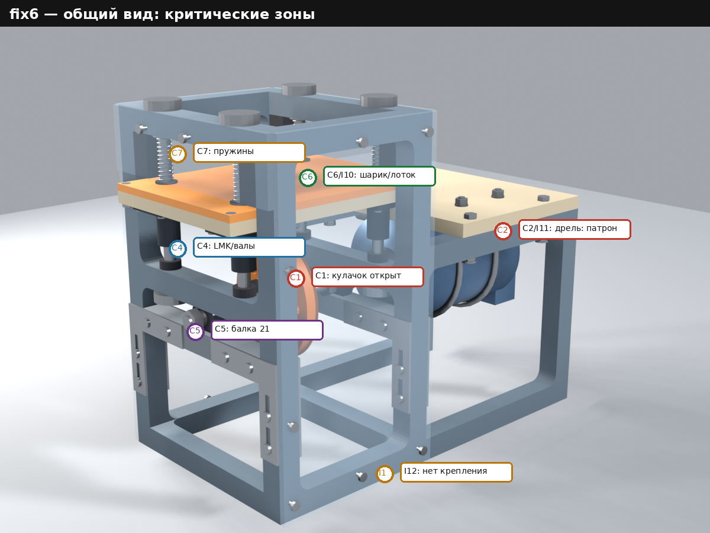
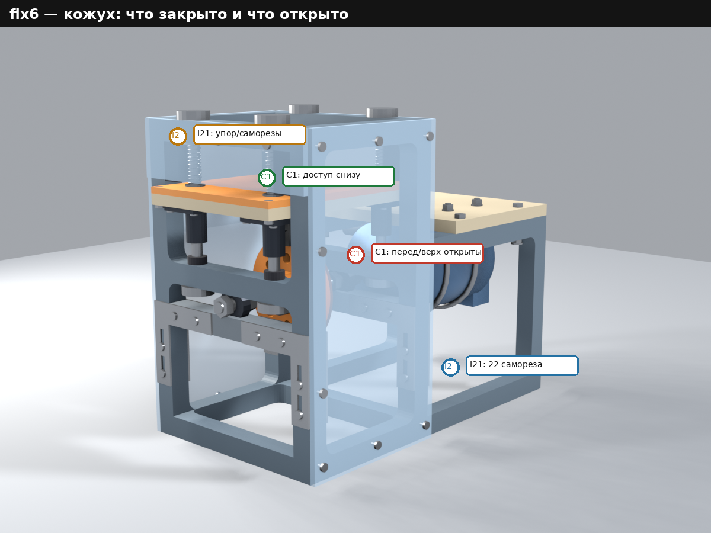
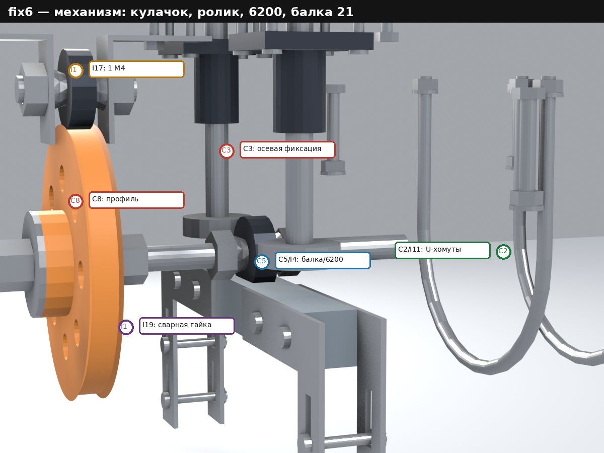
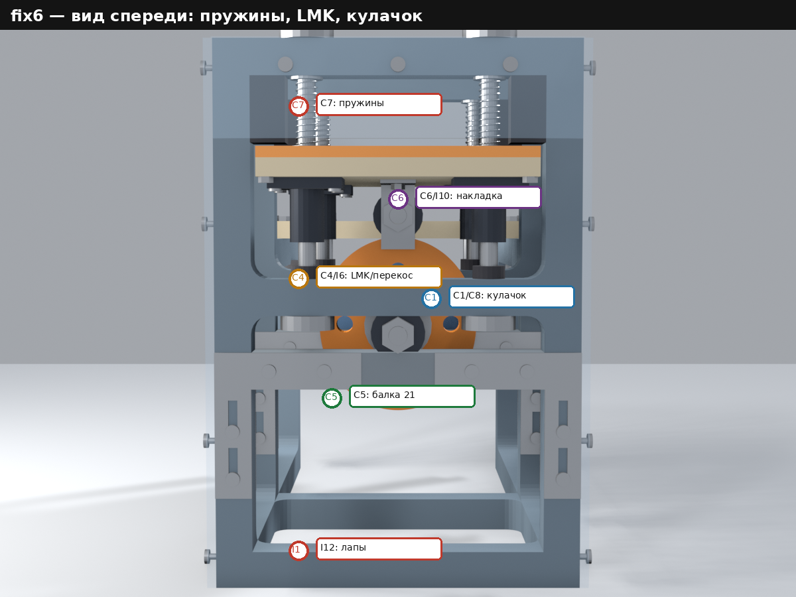

# Отчёт по этапу «Вторая инженерная экспертиза»

Дата: 2026-10-30
Этап: `stages/expert2`
Объект: модель [`stages/fix6`](../fix6/README.md) (рама 360×200×300, 36 позиций)
Инструменты: Python 3.10 (`cad/analysis.py`, NumPy), Pillow, cairosvg; исходные
данные fix6 (`params.csv`, `spec.csv`, `mass.csv`, `checks.csv`, STEP/STL,
рендеры). Модель fix6 **не изменялась**.

## 1. Результат

| Результат | Файлы |
|---|---|
| Отчёт | `Report.md` (этот файл) |
| Вопросы, допущения, что не проверялось | [`Interview.md`](./Interview.md) |
| Реестр 39 замечаний (8 / 23 / 8) | [`findings.csv`](./findings.csv) |
| Числовые проверки экспертизы (55) | [`cad/calc.csv`](./cad/calc.csv) |
| Карта режимов «частота × размах» (33) | [`cad/map.csv`](./cad/map.csv) |
| Воспроизводимый расчёт | [`cad/analysis.py`](./cad/analysis.py) |
| Листы: карта режимов, пружины/контакт, кинематика, силовой путь, осевые стеки | [`fig/`](./fig/) — `operating_map.svg`, `spring_contact.svg`, `kinematics.svg`, `load_path.svg`, `tolerance_stack.svg` |
| Сводный лист A3 | [`fig/expert_sheet.svg`](./fig/expert_sheet.svg), превью [`pic/expert_sheet_preview.png`](./pic/expert_sheet_preview.png) |
| Размеченные рендеры | [`pic/review_iso.png`](./pic/review_iso.png), [`pic/review_shield.png`](./pic/review_shield.png), [`pic/review_mechanism.png`](./pic/review_mechanism.png), [`pic/review_front.png`](./pic/review_front.png) |
| Превью листов | `pic/operating_map_preview.png`, `spring_contact_preview.png`, `kinematics_preview.png`, `load_path_preview.png`, `tolerance_stack_preview.png` |
| Задание следующего этапа | [`../fix7/README.md`](../fix7/README.md) |

**Важно:** в задании этапа указан следующий каталог `fix4`. Это опечатка:
`fix4` уже существует и выполнен. Создан `stages/fix7`; обоснование — в
[`Interview.md`](./Interview.md), вопрос В1.

## 2. Постановка, границы и терминология

Экспертиза — **аналитическая**: проверены геометрия, кинематика, статика,
динамика в первом приближении, прочность/жёсткость, допуски, технологичность
и эксплуатационные риски. Пространственные (FEA), усталостные, модальные и
трибологические расчёты не выполнялись; для них указаны оценки и места,
требующие испытаний.

**Терминология.** В модели fix6 слово «ход» означает **размах**
(peak-to-peak): ход 3/5/10 мм — полный ход стола. В корневом README написано
«амплитуда 3…10 мм» без определения; это неоднозначность, от которой зависит
выполнение обязательного требования (C6, вопрос В2). В формулах ускорения
`a = A·ω²` амплитуда `A` равна половине размаха; для 2-лепесткового кулачка
частота стола в два раза больше частоты вала.

**Что нового по сравнению с первой экспертизой.** fix4…fix6 выполняли
замечания пользователя, а не C1–C7 первой экспертизы (в fix4 прямо сказано,
что `promos.md` не выполнять). Поэтому семь прежних критичных замечаний в
основном остаются; fix6 исправил только осевой зажим 6200. Вторая экспертиза
добавила новое критичное C8 — фактическую кинематику 2-лепесткового кулачка.

**Допущения** (подробно — в `Interview.md`):

- пружина 12×1,0, D=11, n=11, сталь; k≈0,677 Н/мм;
- реальные массы LMK10UU ≈45 г, 6200 ≈15 г;
- PLA: E≈3,5 ГПа, ν≈0,35; PETG: E≈2,0 ГПа; сталь: E=200 ГПа;
- движущаяся масса стола ≈0,916 кг;
- профиль кулачка — полярный 2-лепестковый r=50−e−e·cos2θ, как в fix6;
- ролик — 6200 Ø30 (R=15), контакт линейный;
- дрель — заглушка Ø100, X=210…340; патрон/рукоятка не смоделированы.

Все числа — в [`cad/calc.csv`](./cad/calc.csv) (55 проверок: 12 OK, 10 WARN,
30 FAIL, 3 INFO) и [`cad/map.csv`](./cad/map.csv) (33 режима). FAIL в
`calc.csv` не равен «критичному»: часть FAIL — точность, документация и
отсутствие исходных данных; критичность определена отдельно в
[`findings.csv`](./findings.csv).

## 3. Модель fix6 в цифрах

| Узел | Значение (fix6) |
|---|---|
| Рама | PETG, одним куском, 360×200×300, сплошное 20×20, 1,885 кг, 26 галтелей R10 |
| Виброотсек / вынос | 160 / 200 мм |
| Стол / накладка | 200×150×10 / 200×150×6, PLA; вогнутость Ø140×2 |
| Направляющие | 4×Ø10, L=166, X=10/150, Y=50/150; LMK10UU (4); отверстия Ø10,5 |
| Пружины | 4×Ø12×1,0, L0≈55, установленная 36 мм; **k не задана** |
| Вал привода | шпилька M10, X=−10…215; 6200 в X=10 и 150; 4 конуса + 4 nyloc |
| Кулачок | X=74…86; 2 лепестка R40…50; 8×Ø10 R32; буртик Ø40×10; шестигранник 17,1; приваренная гайка 74…82 |
| Ролик | 6200, Z=205; кронштейн 40×40×20×2; один M4 на кронштейн |
| Балки 21 | 2×20×20×159,6, PETG; 8 стальных уголков 60×60×2; 8 M4; положительного упора нет |
| Подстолье | PETG 160×200×12; 4×M6×45; дрель — заглушка Ø100 |
| Кожух | поликарбонат 5 мм; 2 боковые панели 160×300 + 2 бортика до Z=246; 22 самореза |
| Масса без дрели | 6,391 кг по `mass.csv`; ≈6,023 кг с реальными LMK/6200 |
| Движущаяся масса | 0,916 кг (реальная) / 1,225 кг (по `mass.csv`) |
| Геометрические проверки fix6 | 240: 238 OK, 2 предупреждения (пружина ID 10,0; стенка 3 мм у R32) |
| Проверки экспертизы | 55: 12 OK, 10 WARN, 30 FAIL, 3 INFO |

Модель fix6 **геометрически целостна**, но 240 проверок fix6 — статические:
они не проверяют фактический закон движения ролика, контакт, усталость,
тепловое расширение, ограждение и привод. Именно эти проверки и составляют
вторую экспертизу.

## 4. Главный вывод

**Модель нельзя передавать в эксплуатацию.** Восемь замечаний критичны:

- C1 — кожух закрывает только бока; перед/зад/верх и патрон открыты, E-stop и
  блокировки нет;
- C2 — привод «дрель–вал» не определён; конец вала X=215 внутри корпуса
  дрели X=210…340; патрон не смоделирован;
- C3 — 6200 в fix6 зажаты правильно (это принято), но кулачок имеет 14 мм
  осевой свободы и держится только трением через PLA-буртик;
- C4 — направляющие валы не имеют юстировки; перекос до 1,43° (2,75 мм на
  110 мм);
- C5 — балка 21 — нижняя опора 6200 — всё ещё держится трением, положительного
  упора нет;
- C6 — «амплитуда» не определена; на части диапазона 5…15 Гц × 3…10 мм шарик
  не отрывается;
- C7 — жёсткость, свободная длина и преднатяг пружин не заданы; контакт
  ролика 19,7 Н (0,48 от инерционной) на 15 Гц/10 мм;
- C8 — фактическое движение 2-лепесткового кулачка не гармоническое: 4-я
  гармоника 0,505 мм (5,0 % хода), отклонение 0,548 мм (5,5 %), ускорение
  вниз 7,49 мм против 5,00 идеала.

Двадцать три важных замечания ухудшают точность, ресурс, ремонтопригодность
и удобство (смена амплитуды, PETG-карманы, валы без твёрдости, накладка без
удержания шарика, крепление дрели и рамы, кулачок, кожух, моменты затяжки,
документы). Восемь пожеланий не несут прямых рисков, но не позволяют
приблизиться к целям README (минимум точек трения, линейная связь
частоты/амплитуды с геометрией, покупные детали).

В fix7 выполнены **только параметры прижимных пружин** (L0=70, Ø12,
проволока 1,0); остальные C1–C8, I1–I23, W1–W8 остаются. Третья экспертиза
([expert3](../expert3/README.md)) проверила только пружины и контакт ролика.
**До выбора дрели, определения «амплитуды» и критерия гармоничности
следующую корректировку начинать нельзя** — от этого зависят длина вала,
патрон, профиль кулачка, комплект дисков и пружины.

## 5. Критичные замечания

### C1. Ограждение и аварийный останов: закрыты только бока

- **Что изменилось.** fix4 добавил 2 боковые панели 160×300×5 (Y=−5…0 и
  200…205) и 2 наружных бортика до Z=246 на 22 саморезах. Это частичное
  ограждение.
- **Суть.** Перед/зад ниже Z=246 и верх открыты; кулачок X=74…86, Z=140
  доступен через переднее/заднее отверстие; патрон/вал при X≥210 вне кожуха;
  E-stop, концевика дверцы и блокировки нет. Кожух крепится саморезами в PETG.
- **Последствие.** Захват рукава/волос, порез о кулачок/гайки, удар
  вылетевшей деталью; при 450 об/мин (норма) и 900 об/мин (испытание) риск
  серьёзной травмы. Это критично независимо от качества расчётов.
- **Корректировка.** Замкнуть кожух по периметру и сверху; прозрачная
  дверца/крышка с концевиком; закрыть патрон/хвостовик; E-stop/кнопка;
  крепление кабеля; маркировка опасной зоны; зазор ≥10 мм до подвижных
  частей; винты с шайбами/резьбовыми вставками.
- **Приёмка.** Доступ к кулачку/валу/патрону только через блокированную
  дверцу; E-stop разрывает питание; испытание на 900 об/мин (2×450); зазор
  ≥10 мм; кожух не касается стола и пружин.

### C2. Привод «дрель–вал» не определён; вал упирается в корпус дрели

- **Суть.** Вал — шпилька M10, X=−10…215. Условный корпус дрели — X=210…340.
  Конец вала X=215 находится **на 5 мм внутри корпуса**; патрон, кулачки и
  рукоятка не смоделированы. Гладкого хвостовика Ø10 h6, фланца, гибкой муфты
  и осевого упора нет. Вал зажат между патроном и гайками 6200, то есть
  осевое положение задаётся двумя источниками одновременно. Консоль от
  подшипника X=150 до X=215 — 65 мм.
- **Последствие.** Вал не гарантированно входит в патрон; при сборке придётся
  укорачивать вал или сдвигать дрель. Резьба M10 — плохая поверхность для
  кулачков патрона; биение и осевая перегрузка подшипников; возможен
  проворот/выдёргивание вала на 450 об/мин. Консоль 65 мм при 100 Н даёт
  0,210 мм прогиба (I3).
- **Корректировка.** Выбрать реальную дрель, смоделировать патрон и
  рукоятку; выполнить хвостовик Ø10 h6 с лыской или квадратом; поставить
  гибкую муфту (или квадратный привод) и осевой упор; согласовать длину вала
  с патроном; проверить биение.
- **Приёмка.** Хвостовик в патроне ≥20 мм; биение ≤0,05 мм; осевой люфт
  ≤0,2 мм; муфта допускает радиальное/угловое смещение; вал не упирается в
  корпус; после 1 ч на 450 об/мин осевое смещение ≤0,1 мм.

### C3. Осевая и радиальная фиксация кулачка — только трением и сварной гайкой

- **Что изменилось.** fix6 исправил регрессию 6200: 4 конуса + 4 nyloc, стеки
  −8…0 / 0…5,5 / 5,5…14,5 / 14,5…20 / 20…28 и 132…140 / 140…145,5 /
  145,5…154,5 / 154,5…160 / 160…168; зазор до балки/поперечины 0,19 мм. Этот
  узел **принят**; переделывать 6200 не нужно.
- **Суть.** Кулачок 74…86: шестигранник 17,1; приваренная гайка 74…82 длиной
  8 мм; осевая свобода кулачка без зажима 22−8=**14 мм**. Зажим — 2 шайбы,
  2 гайки и 2 контргайки через PLA-буртик 64…74 и диск; положительного
  буртика, стальной втулки или шпонки нет. Момент затяжки не задан; PLA
  ползёт; тепловое расширение меняет затяжку.
- **Последствие.** При ослаблении кулачок смещается по оси; ролик выходит из
  ложбинки (ширина 9,5 при ролике 9), стол теряет опору и падает; ролик/
  кронштейн бьёт по кулачку; на 450 об/мин возможен вылет кулачка. Радиальную
  опору даёт приваренная гайка 17 AF в PLA-шестиграннике 17,1; сварка может
  дать эксцентриситет и биение; правая 4 мм диска не оперты.
- **Корректировка.** Ступенчатый вал с буртиком/стальной втулкой; шпонка или
  лыска; положительный осевой упор; стальная шайба/втулка в кулачке; задать
  момент и фиксатор резьбы; контроль после обкатки.
- **Приёмка.** Осевое смещение кулачка ≤0,1 мм; радиальное биение ≤0,05 мм;
  кулачок не проворачивается при 2× номинальном моменте; после 1 ч — без
  смещения.

### C4. Направляющие валы без юстировки параллельности

- **Суть.** 4 LMK10UU на валах Ø10 стоят в печатных отверстиях Ø10,5 (зазор
  0,5 мм) длиной 20 мм. Вал может наклоняться в пределах зазора:
  `atan(0,5/20)=1,43°`; на базе 110 мм между верхней и средней поперечинами
  это даёт **2,75 мм**. Кольцевые ограничители фиксируют вал по оси, но не
  задают угол. LMK10UU требует параллельности порядка 0,02…0,05 мм.
- **Последствие.** Заклинивание стола, повышенный износ шариков LMK,
  непостоянное трение и перекос стола; при сборке «как получится» устройство
  может не двигаться вовсе.
- **Корректировка.** Отдельные регулируемые опоры валов (сухари с пазами и
  шайбами) или расточка H7 и шлифованные валы с буртиками; юстировка по
  индикатору; рассмотреть 2 вала/4 втулки или самоустанавливающиеся втулки.
- **Приёмка.** Параллельность ≤0,02 мм на 100 мм; стол перемещается без
  закусывания на всём ходе; усилие страгивания ≤20 Н; проверка индикатором.

### C5. Балка 21 — нижняя опора 6200 — всё ещё держится трением

- **Что изменилось.** fix4 добавил 8 стальных уголков 60×60×2 (по 2 на конец
  балки) и 8 M4. Это улучшило жёсткость, но не создало положительного упора.
- **Суть.** Две балки 21 — единственная нижняя опора двух 6200. Каждая
  держится 8 прижимными M4 через PETG-стойки и 8 M4 через PETG-балку;
  положительного упора, шпонки или страховочной скобы нет. Нагрузка на опору
  (реакция кулачка) — 25…95 Н, плюс вибрация.
- **Последствие.** При ослаблении болтов или фреттинге в PETG балка сползает
  вниз; наружное кольцо 6200 выпадает из кармана; вал/кулачок проседает;
  вращающийся кулачок бьёт по ролику/кронштейну. Это отказ безопасности, а не
  только потеря точности.
- **Корректировка.** Положительный упор (буртик/шпонка/стальной кронштейн)
  под балкой 21; домкратный винт/клин для регулировки; страховочная скоба под
  6200; контроль момента; замена трения на зацепление.
- **Приёмка.** Балка выдерживает 3× статическую нагрузку без смещения; после
  1 ч вибрации 15 Гц смещение ≤0,05 мм; 6200 не выпадает при ослаблении
  одного болта.

### C6. Не весь диапазон 5…15 Гц × 3…10 мм даёт отрыв шарика

- **Суть.** Шарик отрывается от стола, когда ускорение стола вниз превышает
  `g`: `a_max = A·ω² = (s/2)·(2πf)² > g`, где `s` — размах. Пороги:

  | Размах s, мм | A=s/2, мм | f_thr, Гц | Шарик не отрывается |
  |---:|---:|---:|---|
  | 3 | 1,5 | 12,87 | 5…12,8 Гц |
  | 5 | 2,5 | 9,97 | 5…9,9 Гц |
  | 10 | 5,0 | 7,05 | 5…7,0 Гц |

  При 5 Гц и размахе 10 мм `a_max=4,93 м/с² < 9,81`; шарик не покидает
  стол. При 5…7 Гц **ни один** диск не даёт отрыва. Если в ТЗ «амплитуда» —
  нуль-пик, то пороги равны 9,10/7,05/4,98 Гц, а текущие диски 3/5/10 по
  размаху дают амплитуду 1,5/2,5/5 мм, то есть **не покрывают** требуемые
  3…10 мм. Фактический 2-лепестковый профиль (C8) поднимает пороги до
  13,72/10,88/8,35 Гц, то есть бесполезная зона ещё больше.
- **Последствие.** На части обязательного диапазона эксперимент «время между
  соударениями» физически не воспроизводится: шарик лежит и колеблется вместе
  со столом. 2 лепестка дают 5…15 Гц стола при 150…450 об/мин вала (не
  300…900, как в первой экспертизе).
- **Корректировка.** Уточнить определение амплитуды; опубликовать карту
  режимов; расширить комплект дисков (например, 6/10/20 мм размаха или
  3/5/10 мм нуль-пик) или сузить частотный диапазон; предусмотреть удержание
  шарика; проверить с шариками 20 и 33 г.
- **Приёмка.** Для каждого режима эксперимента `a_max≥1,5g`; карта режимов
  в паспорте; шарик остаётся в лотке; время между ударами измеряется.

### C7. Жёсткость, свободная длина и преднатяг пружин не заданы

- **Суть.** В `spec.csv` указаны только Ø12×1,0, L0≈55 и установленная длина
  36 мм; жёсткость, число активных витков, материал и допуск L0 отсутствуют.
  Для типовой пружины 12×1,0 с D=11 и n=11:
  `k=G·d⁴/(8·D³·n)=0,677 Н/мм`, четыре пружины — 2,708 Н/мм, преднатяг при
  L=36 — 51,5 Н. Движущаяся масса ≈0,916 кг; на 15 Гц и размахе 10 мм
  инерционная сила 40,8 Н, сила пружины в верхней точке 51,5 Н, сила контакта
  по идеальной синусоиде **19,7 Н (0,48 от инерционной)**; по фактическому
  профилю — 31,4 Н (0,77). Собственная частота 8,64 Гц лежит внутри 5…15 Гц.
  Минимальная L0 для контакта 15 Гц/10 мм — 47,7 мм; при L0=45 мм контакт
  отрицательный.

  | k, Н/мм | 4k, Н/мм | F пружины сверху, Н | F инерции (15 Гц/10 мм), Н | F контакта, Н | Запас | f_соб, Гц |
  |---:|---:|---:|---:|---:|---:|---:|
  | 0,677 | 2,708 | 51,5 | 40,8 | 19,7 | 0,48 | 8,64 |
  | 1,0 | 4,0 | 76,0 | 40,8 | 44,2 | 1,08 | 10,50 |
  | 1,3 | 5,2 | 98,8 | 40,8 | 67,0 | 1,64 | 11,97 |
  | 1,5 | 6,0 | 114,0 | 40,8 | 82,2 | 2,01 | 12,86 |
  | 2,0 | 8,0 | 152,0 | 40,8 | 120,2 | 2,95 | 14,85 |
  | 2,2 | 8,8 | 167,2 | 40,8 | 135,4 | 3,32 | 15,57 |

- **Последствие.** При более мягкой пружине, меньшей L0 или большей массе
  ролик отрывается от кулачка; стол падает и бьёт по кулачку, амплитуда и
  гармоничность теряются. Допуск L0 −10 мм (45 мм) уже даёт отрицательный
  контакт. f_соб=8,64 Гц внутри рабочего диапазона — резонанс.
- **Корректировка.** Задать k, L0, число витков, материал и допуск; выбрать
  k≥1,5 Н/мм (запас 2×) или 8…12 пружин; добавить регулировку преднатяга
  (шайбы/винты) и демпфирование; вывести f_соб из 5…15 Гц (k≥2,2 Н/мм) или
  поставить демпфер; проверить отрыв ролика.
- **Приёмка.** Сила контакта ≥2× инерционной на всех режимах; f_соб вне
  5…15 Гц; преднатяг регулируется; после 1 ч работы амплитуда ±0,2 мм от
  заданной; контроль индикатором/датчиком.

### C8. Фактическое движение 2-лепесткового кулачка не гармоническое

- **Суть.** Профиль fix5/fix6 задан полярной функцией
  `r(θ)=50−e−e·cos2θ`. Но ролик идёт по нормали к профилю, поэтому
  фактический подъём ролика — не `r(φ)`, а опорная функция
  `h(φ)=max_θ r(θ)·cos(θ−φ)`. Для круга они совпадают; для 2-лепесткового
  профиля появляются 4-я и 6-я гармоники. Расчёт (1441×3601 точек):

  | Ход | 4-я гармоника | 6-я | Отклонение от синусоиды | Порог отрыва (факт) |
  |---:|---:|---:|---:|---:|
  | 3 мм | 0,048 мм (1,6 %) | 0,006 | 0,047 мм (1,6 %) | 13,72 Гц |
  | 5 мм | 0,132 мм (2,6 %) | 0,020 | 0,132 мм (2,6 %) | 10,88 Гц |
  | 10 мм | **0,505 мм (5,0 %)** | 0,135 | **0,548 мм (5,5 %)** | **8,35 Гц** |

  Для 10 мм коэффициент ускорения вверх/вниз — 7,49/3,56 мм против идеальных
  5,00/5,00; движение асимметрично. Контакт внизу — около 95 Н вместо 74 Н;
  пиковое ускорение вверх в 1,5 раза выше идеального.
- **Последствие.** Обязательное требование «характер колебаний —
  гармонический» не выполняется: 4-я гармоника 5 % и асимметрия ускорений
  меняют отрыв шарика, время между ударами и нагрузку на кулачок/ролик/раму.
  Порог отрыва для 10 мм сдвигается с 7,05 до 8,35 Гц (C6); внизу контакт
  растёт на 28 %. Это не «косметика»: модель проверяла только `r(θ)` и ход,
  а не закон движения.
- **Корректировка.** Строить кулачок как внутреннюю эквидистанту желаемой
  кривой центров ролика `Rc(φ)=65−e−e·cos2φ` (offset 15 мм), а не как
  полярный профиль; проверить `h(φ)`, `v(φ)`, `a(φ)`; цель — 4-я гармоника
  ≤2 % хода и симметрия ускорений.
- **Приёмка.** `h(φ)` отличается от цели ≤0,1 мм; 4-я гармоника ≤2 %;
  ускорения вверх/вниз отличаются ≤10 %; карта режимов и контакт пересчитаны.

## 6. Важные замечания

| ID | Статус | Замечание и доказательство | Корректировка |
|---|---|---|---|
| I1 | частично | Смена амплитуды: блок собран, но нужно ослабить 16 M4, опустить балки на 15 мм, блок на 44 мм, выдвинуть; домкрата нет; в спецификации один блок/один кулачок, дисков три. | Быстросъёмный кулачок на шпонке/фланце; набор 3 дисков; шкала; инструкция. |
| I2 | остаётся | README: сварная сталь 20×20×1,5 и стол по Y; модель: PETG 20×20 сплошной, стол 200×150 по X, 1,885 кг. | Обновить README или зафиксировать решение; один источник истины. |
| I3 | остаётся | Шпилька M10: d3=8,16; прогиб 0,131 мм при 100 Н; напряжение 65,6 МПа; консоль 65 мм — 0,210 мм; гладких поясов/буртиков нет. | Ступенчатый шлифованный вал Ø10/Ø12, пояса h6, буртики. |
| I4 | частично | 6200 в PETG-карманах R15×5, ширина 9,4, осевой зазор 0,2; стальные уголки 2 мм улучшили балку, но посадочные места — PETG; при износе люфт/стук. | Стальные/расточенные вкладыши; осевой преднатяг 0,02…0,05; контроль. |
| I5 | остаётся | Направляющие — «пруток, резка»; LMK требует h6 и HRC60; мягкий пруток изнашивается. | Покупные шлифованные валы Ø10 h6, HRC60, Ra≤0,4. |
| I6 | остаётся | 4 LMK в одной плоскости на базе 140×100; перекос 0,05…0,1 мм; при непараллельности — закусывание. | Две втулки на вал/каретки; увеличить базу; индикатор. |
| I7 | остаётся | Верх стола 241 у всех дисков, низ 238/236/231; средняя высота 239,5/238,5/236; преднатяг и высота шарика меняются; регулировки нет. | Общая база; шайбы/винты преднатяга; шкала высоты. |
| I8 | частично | PETG-рама одним куском 1,885 кг, 26 галтелей R10, верхние внутренние углы без галтелей; f_соб ≈17,7 Гц; ремонт — перепечатка. | Разъёмная/гибридная рама; галтели во всех стыках; циклические испытания. |
| I9 | остаётся | Карманы R15 и Ø10,5 печатаются с поддержками; FDM ±0,2 мм; расточки/кондуктора нет. | Расточка/развёртывание по кондуктору; контроль координат. |
| I10 | остаётся | Накладка PLA, вогнутость Ø140×2; шарик 20/33 г при 10 мм/15 Гц покидает лоток; борта/кольца нет; боковые панели кожуха шарик не удерживают. | Борт/прозрачное кольцо 10…15 мм; сменная пластина 2 мм; глубже лоток. |
| I11 | остаётся | U-хомут 100 мм, корпус-заглушка Ø100 (нулевой зазор); рукоятка/курок/патрон не смоделированы; фактическая дрель может не поместиться. | Выбрать дрель; регулируемые хомуты/сёдла; резиновая подкладка. |
| I12 | остаётся | README требует струбцины, но в раме 0 отверстий/площадок; лапы 20×20 PETG мнутся; при 15 Гц возможен уход. | 4×M6 в нижних балках; стальные/фанерные подкладки; коврик; схема. |
| I13 | новое | checks.csv проверяет только r(θ), ход 2e и касание; h(φ), v, a и 4-я гармоника не проверяются; расчёт C8 даёт 5,5 % отклонения. | Кинематическая проверка h/v/a; стенд с датчиком/акселерометром. |
| I14 | остаётся | Частота задаётся дрелью без тахометра; зависит от нагрузки/сети; требуется 5…15 Гц (150…450 об/мин). | Метка на валу + тахометр/стробоскоп; калибровка; encoder/VFD. |
| I15 | остаётся | mass.csv 6,391 кг; с реальными LMK/6200 — 6,023 кг; движущаяся 1,225/0,916 кг; пружина 2,4 г — оболочка. | Взвесить; обновить mass.csv и динамику. |
| I16 | частично | Блок собран, но опускание на 44 мм и балки на 15 мм — вручную, 16 M4, без домкрата/упора; один человек держит ~0,5 кг. | Домкратный винт/клин, направляющие, страховочный упор; процедура. |
| I17 | остаётся | Каждый кронштейн 2 мм крепится одним потайным M4 в пазу 10×4,5; горизонтальная сила кулачка и вибрация; второго болта/шпонки нет. | Два M4 или M4 + шпонка/штифт; стальная шайба/вставка; упор по X. |
| I18 | частично | Поз. 20: «Ø10, хвостовик Ø10» при M10; поз. 3: ID 10,2 при номинале 10,0; поз. 35: 4 конуса + 4 гайки, а поз. 17 — 6 конусов; поз. 16 — 8 контргаек; README — сталь при PETG; масса 6,39/6,02. | Обновить spec/params/отчёт/README; проверка согласованности. |
| I19 | новое | Радиальная опора кулачка — приваренная гайка 17 AF длиной 8 мм в PLA-шестиграннике 17,1; зазор 0,05; стальной втулки/шпонки нет; сварка может дать эксцентриситет; правая 4 мм диска не оперты. | Стальная втулка/ступица h6 + шпонка/лыска; контроль биения; заменить приварную гайку. |
| I20 | новое | Кулачок 10 мм: 8×Ø10 R32, стенка на R40 — 3 мм; бортик 1,25 мм; PLA 100 %; контакт внизу ~95 Н; риск усталости/скола. | Ø8/R30 или R34; стенка ≥4…5 мм; стальная вставка; 10^6 циклов. |
| I21 | новое | Кожух — жёсткий упор на +5 мм: бортик Z=246 при столе 241; при +5,1 пересечение 150 мм³; буферы на 244; 22 самореза в PETG; при отрыве буфера стол бьёт в поликарбонат. | Мягкий упор до кожуха; буферы на болтах; винты с шайбами/вставками; дверца с концевиком. |
| I22 | новое | Затяжка конусов 6200 не задана: 4 конуса + 4 nyloc; внутреннее кольцо зажато с двух сторон; 300 Н — 8,7 МПа; 5 Н·м — ~2500 Н; nyloc не создаёт контрнатяг; PETG/сталь — разница 0,14 мм при ΔT=20 К. | Момент; обычная гайка + фиксатор или nyloc с контролем; тепловой зазор/плавающая опора. |
| I23 | новое | Нет карты моментов для конусов, кулачка, LMK, балки 21, U-хомутов, подстолья; фиксатор резьбы/контроль не указаны. | Карта моментов, фиксатор, метки, контроль после обкатки, журнал. |

## 7. Пожелания

| ID | Пожелание | Почему |
|---|---|---|
| W1 | Сократить число движущихся частей и точек трения | 4 LMK, 3 6200, 4 пружины, 8 конусов, 8 контргаек, 16+ винтов; пожелание README п. 1. |
| W2 | Линейно выразить частоту и амплитуду через геометрию | Амплитуда — диск, частота — дрель; связи с геометрией нет; пожелание README п. 6. |
| W3 | Модульная/гибридная рама вместо одной печатной детали | 1,885 кг PETG одним куском; ремонт — перепечатка; пожелание «покупные детали». |
| W4 | Заменить бытовую дрель приводом с обратной связью | Дрейф оборотов, шум, вибрации подстолья; стабильность частоты. |
| W5 | Стандартные покупные опоры вместо печатных карманов | 6200 в PETG, балка 21 на 2 мм уголках; пожелание «покупаемые детали». |
| W6 | Демпфирование стола/пружин | f_соб≈8,64 Гц внутри 5…15; резонансные силы/шум. |
| W7 | Инструментарий и протокол эксперимента | Нет шкалы амплитуды, тахометра, держателя микрофона, шаблона протокола. |
| W8 | Обслуживание и быстрая замена расходников | Кулачок/накладка/ударная пластина — расходники; доступ требует разборки; нет меток моментов и ЗИП. |

## 8. Числовые проверки

Полный список — [`cad/calc.csv`](./cad/calc.csv) (55 строк: 12 OK, 10 WARN,
30 FAIL, 3 INFO) и [`cad/map.csv`](./cad/map.csv) (33 режима). Ключевые:

| Проверка | Значение | Норма / вывод |
|---|---|---|
| Масса без дрели: модель / реальная | 6,391 / 6,023 кг | модель завышена на 0,37 кг |
| Движущаяся масса: модель / реальная | 1,225 / 0,916 кг | для динамики — 0,916 |
| Пружина: k при 11 витках | 0,677 Н/мм | в спецификации не задана |
| Пружина: преднатяг / f_соб | 51,5 Н / 8,64 Гц | f_соб внутри 5…15; нужен демпфер |
| Контакт ролика, 15 Гц/10 мм | 19,7 Н (0,48) по идеалу; 31,4 Н (0,77) по факту | цель ≥2× (81,6 Н) |
| Минимальная L0 для контакта 15/10 | 47,7 мм | при L0=55 запас 7,3 мм; допуск не задан |
| Порог отрыва шарика (размах 3/5/10) | 12,87 / 9,97 / 7,05 Гц | при 5 Гц ни один диск не отрывает |
| Порог отрыва (нуль-пик 3/5/10) | 9,10 / 7,05 / 4,98 Гц | диски 3/5/10 не покрывают 3…10 |
| Фактический порог (3/5/10) | 13,72 / 10,88 / 8,35 Гц | 4-я гармоника поднимает порог |
| 4-я гармоника h(φ) | 0,048 / 0,132 / 0,505 мм | 5,0 % для 10 мм; цель ≤2 % |
| Ускорение вверх/вниз (10 мм) | 7,49 / 3,56 мм | идеал 5,00/5,00; асимметрия |
| Кулачок: кривизна max/min (10 мм) | 35,7 / 80,0 мм | >15; подреза нет |
| Кулачок–ролик: p0 при 100 Н | 36,2 МПа | PLA 100 %; усталость |
| Стенка кулачка на минимуме (10 мм) | 3,0 мм | цель ≥4 мм |
| Бортик ложбинки | 1,25 мм/сторона | цель ≥2 мм |
| Осевая свобода кулачка | 14 мм | цель ≤0,1 мм |
| Вал M10: прогиб / напряжение | 0,131 мм / 65,6 МПа | при 100 Н; консоль 0,210 мм |
| Направляющая в Ø10,5 | 1,43°; 2,75 мм на 110 мм | LMK 0,02…0,05 мм |
| Балка 21: положительный упор | 0 | только трение + 8 уголков |
| Кожух: перед/зад/верх, E-stop | открыто / 0 | C1 |
| Дрель: U-хомут 100 / корпус 100 | 0 мм | реальная дрель не выбрана |
| Рама: отверстия крепления | 0 | 4×M6 |
| Рама: f_соб | ≈17,7 Гц | близко к 15 Гц |
| Спецификация/README | ≥4 расхождения | обновить документы |

**Проверка масс.** Модель `mass.csv` даёт 6,391 кг; реальные LMK10UU (4×45 г)
и 6200 (3×15 г) уменьшают итог на ≈0,37 кг — до ≈6,023 кг. Движущаяся масса:
0,916 кг с реальными LMK/6200 (стол 363 г, накладка 200 г, LMK 180 г,
кронштейн 46 г, ролик 15 г, ось/гайки 55 г, крепёж 17 г, шайбы 8 г, шарик
33 г); 1,225 кг по `mass.csv` (LMK/6200 — сплошные).

**Проверка шарика.** Карта режимов — [`fig/operating_map.svg`](./fig/operating_map.svg)
и [`pic/operating_map_preview.png`](./pic/operating_map_preview.png). Красная
область — режимы, где шарик не отрывается; линии — диски 3/5/10; точки —
идеальные пороги, крестики — фактические. При 5 Гц и размахе 10 мм ускорение
4,93 м/с², вдвое меньше g; при 5…7 Гц отрыва нет ни на одном диске.

**Проверка пружин.** [`fig/spring_contact.svg`](./fig/spring_contact.svg):
слева — сила пружин от перемещения для k=0,68/1,0/1,3/1,5/2,0; справа — сила
контакта при 15 Гц для дисков 3/5/10. При k=0,68 и 10 мм контакт 19,7 Н
(0,48); при k=1,5 — 82,2 Н (2,0); при 2,0 — 120,2 Н (2,9). Спецификация
должна задать k и L0; допуск L0 −10 мм уже даёт отрыв.

**Проверка кинематики.** [`fig/kinematics.svg`](./fig/kinematics.svg): слева —
полярный профиль 10 мм, желаемая кривая центров ролика и ролик; справа —
фактический h(φ) и идеальная синусоида; внизу — 4/6/8-я гармоники. Для 10 мм
4-я гармоника 0,505 мм (5,0 %), отклонение 0,548 мм (5,5 %); ускорение вниз
7,49 мм против 5,00. Это главная новая находка C8.

**Проверка вала.** [`fig/load_path.svg`](./fig/load_path.svg) и
[`fig/tolerance_stack.svg`](./fig/tolerance_stack.svg): прогиб 0,131 мм при
100 Н, напряжение 65,6 МПа, консоль 65 мм — 0,210 мм; перекос в печатном
отверстии до 1,43° (2,75 мм на 110 мм). Для вала нужны гладкие пояса/буртики
и юстировка. Осевой стек 6200 (4 конуса + 4 nyloc) корректен; кулачок имеет
14 мм осевой свободы.

## 9. Визуальные проверки

Размеченные рендеры fix6 (цветные метки — номера замечаний):



- `C1` — кулачок открыт спереди; `C7` — пружины; `C4` — LMK/валы;
  `C6/I10` — шарик/лоток; `C5` — балка 21; `C2/I11` — дрель/патрон;
  `I12` — нет крепления к станине.



- `C1` — бока закрыты, перед/верх открыты, доступ снизу; `I21` — жёсткий
  упор/22 самореза.



- `C8` — 2-лепестковый профиль; `I17` — кронштейн на одном M4;
  `C5/I4` — балка 21/6200; `C2/I11` — U-хомуты; `I19` — кулачок на сварной
  гайке; `C3` — осевая фиксация.



- `C7` — пружины; `C4/I6` — LMK/перекос; `C1/C8` — кулачок; `C5` — балка 21;
  `C6/I10` — накладка; `I12` — лапы.

Расчётные листы:

- [`operating_map.svg`](./fig/operating_map.svg) — карта «частота × размах»,
  идеальные и фактические пороги, 150…450 об/мин;
- [`spring_contact.svg`](./fig/spring_contact.svg) — силы пружин и контакта;
- [`kinematics.svg`](./fig/kinematics.svg) — профиль, h(φ), гармоники;
- [`load_path.svg`](./fig/load_path.svg) — силовой путь: пружины, LMK, кулачок,
  балка 21, 6200, дрель, кожух;
- [`tolerance_stack.svg`](./fig/tolerance_stack.svg) — осевые стеки 6200 и
  кулачка, перекос направляющей, тепловое расширение;
- [`expert_sheet.svg`](./fig/expert_sheet.svg) — сводный лист A3 (рендер +
  реестр + ключевые числа).

## 10. Ограничения экспертизы

- Нет FEA, модального, усталостного и трибологического расчёта; оценки вала,
  рамы, кулачка и подстолья — первого порядка.
- Нет испытаний на вибростенде, измерений амплитуды/частоты, ресурса LMK,
  износа PLA-кулачка и PETG-карманов.
- Нет реальной модели дрели: патрон, рукоятка, курок, масса и центр масс
  неизвестны; выводы C2/I11 — по заглушке.
- Жёсткость пружины 0,677 Н/мм — оценка для 12×1,0, D=11, n=11; фактическая
  пружина может отличаться; поэтому C7 требует задания k/L0/допуска.
- Массы покупных LMK/6200 — каталожные оценки; для динамики нужны
  взвешивание и пересчёт.
- «Амплитуда» в ТЗ не определена; C6 и карта режимов даны для размаха и
  отдельно отмечен вариант нуль-пик.
- C8 — кинематический расчёт жёсткого ролика по выпуклому профилю; удар
  шарика, податливость PLA и динамика рамы не моделировались. Но 4-я
  гармоника и асимметрия ускорений — свойство геометрии, не оценка.
- Экспертиза не заменяет испытания: после fix7 нужны статическая сборка,
  прокрутка без нагрузки, 1 ч на 15 Гц, измерение амплитуды и температуры,
  проверка затяжек, шарики 20 и 33 г.

## 11. Воспроизведение

```bash
cd stages/expert2/cad
python3 analysis.py          # calc.csv, map.csv, findings.csv, fig/*.svg,
                             # pic/review_*.png, pic/*_preview.png
```

Скрипт читает `stages/fix6/params.csv`, `cad/mass.csv`, `cad/checks.csv`, не
меняет fix6 и не требует FreeCAD. Все числа в отчёте получены из
`analysis.py`; при изменении профиля, k, массы или геометрии их нужно
пересчитать.

## 12. Стоимость генерации

Модель `deepseek/deepseek-flash` (variant high): вход $0,15/млн, чтение кэша
$0,003/млн, выход (включая reasoning) $0,60/млн. Учёт — `session_v2`
OpenCode, сессия `ses_e726e0ef1ffeC8VnXNji0HrEe0`; снимок на 2026-10-30 после
формирования отчёта и fix7. Последующие вызовы, включая финальный ответ,
читают тот же кэш и могут добавить ориентировочно $0,01…0,03; в таблице —
учтённое на момент снимка.

| Категория | Токены | Стоимость, USD |
|---|---:|---:|
| **Всего** | **16 517 019** | **0,16652** |
| Входящие мимо кэша | 129 986 | 0,01950 |
| Закешированные входящие | 16 223 104 | 0,04867 |
| Исходящие (включая reasoning) | 163 929 | 0,09836 |

Исходящие = 69 462 (output) + 94 467 (reasoning). Итог по этапу expert2 на
момент снимка: **16,52 млн токенов, $0,16652** (без стоимости предыдущих
этапов `model`…`fix6`). Стоимость служебных вызовов инструментов и подсессий
не входит. Финальный ответ и последние правки читают тот же кэш и могут
добавить ориентировочно $0,002…0,005.
