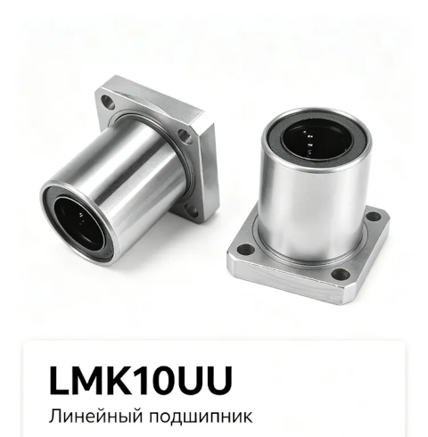
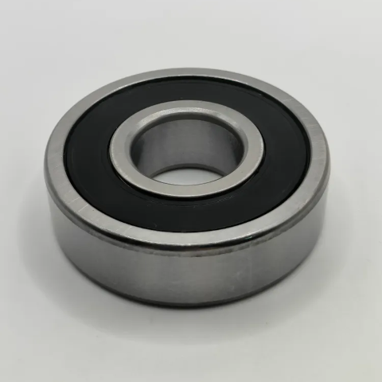
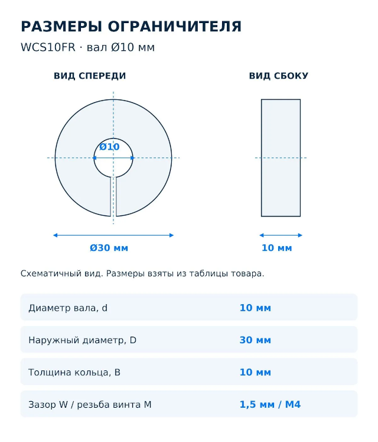
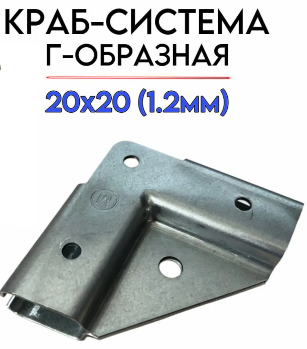
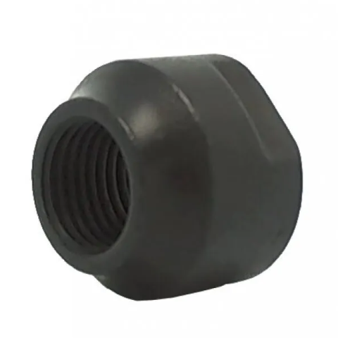
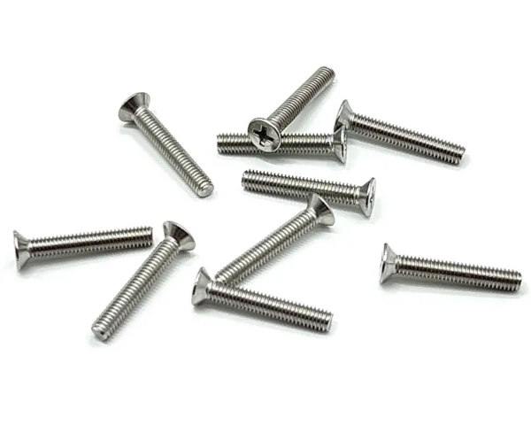
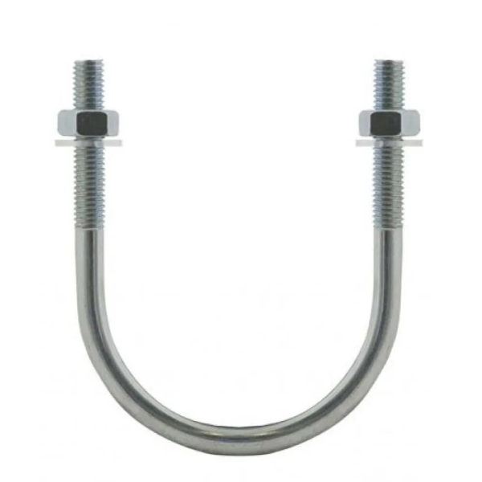
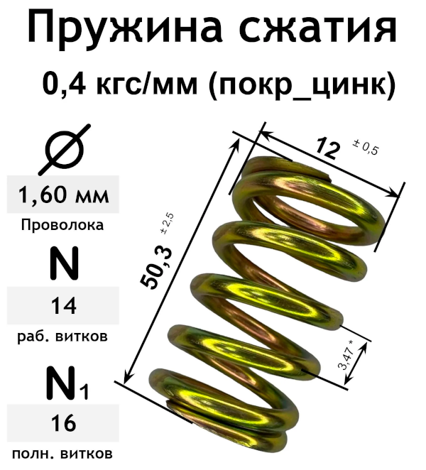

# Устранение замечания по первоначальной версии модели 

Доработать первоначальную модель.

С учетом замечаний ниже сделать.

- 3D модель в установленном формате 
- эскиз в 3 проекциях: вид сбоку и вид слева
- трёхмерное изображение конструкции.
- спецификацию деталей
 
## Замечания по конструкции

### Рама

0. Рама будет отпечатана из пластика на 3В принтере одним куском.

1. Средняя поперечная балка (параллельная полу) с боковых сторон - лишняя. 
Валы будут крепиться не к ней, а к средней поперечной балке с переднего торца 
изделия и к средней поперечной балке, граничащей с выносом.

2. Серединная балка с вырезом под кулачковый диск - лищняя. Верхними упорами для
крепления подшипников основного приводного вала будут средняя поперечина с
переднего торца и средняя поперечина, граничащая с выносом. В ниж и будут 
зажаты подшипники основного вала привода и к ним же будут крепиться снижу валы

3. Стыки и сочленения рамы должня быть гладкими без перепадов и выступов.

4. Нижняя поперечина с заднего торца - лишняя. Она будет мешать установке
дрели. Жесткость конструкции должно обеспечить подстолье.

### Балка фиксации подшипников

1. Балка фиксации подшипников - это отдельная деталь такого же профиля и сечения
как балки рамы.

2. Подшипники вала основного привода оказываются зажаты между 
    - выемкой на нижней грани средней поперечины с переднего торца
    - выемкой на верхней грани балки фиксации подшипников
Аналогичный принцип для подшипника зажатого поперечиной на границе выноса и
второй балкой фиксации подшипников

3. Балка фиксации подшипников идёт ниже средней поперечины на переднем торце 
параллельно ей и полу. Концами она упирается в вертикальные стойки с переднего 
торца и крепится к ним Т-образной краб-системой. Аналогично для второй балки и
средней поперечины на границе с выносом

4. Во время эксплуатации граб-система может быть ослаблена, балка фиксации
подщипников опущена вниз по стойке, а подшипники основного вала освобождены 
для замены вала основного привода.

### Стол и накладка на стол

1. И стол и накладка на стол будут распечатаны на 3D принтере. Почему не
распечатать из сразу единым куском? Потому что есть сомнения в конечном выборе
верхней поверхности стола.

2. Стол выдаётся за пределы рамы с переднего торца и с границы с выносом.
Вертикальных стоек с боков он не касеется, там остаётся расстояние по 5 мм.
Таким образом стол вытянут по оси вала основного привода.

### Положение валов

Валы крепятся фиксаторами валов за верхнюю и среднюю поперечины с переднего 
торца с помощью ограничителей вала. Аналогично за верхнюю и среднюю поперечины
на границе с выносом.

### Крепление накладки к столу

Накладка к столу должна крепиться не в середине, а по углам. Так же с помощью
потайных полтов и контрагаек с обратной стороны стола.

Все гайки испытывающие колебания вместе со столом должны быть с самоконтрящимся
пластиковым кольцом.

## Замечания по деталям

### Прижимные пружины

Между пружиной и столом, а так же между прудиной и поперечниой должны быть шайбы 
для надёжного сцепления пружин с поверхностью.

### Кулачковые диски

Отверстие под вал должно иметь небольшую фаску для более надёжного прижима
коническими подшипниками

### Дрель 

Должна крутиться простив часовой стрелке, чтобы избежать
самооткручивание гаек на основном приводно валу. Должна иметь мягкий пуск,
регулировку оборотов и фиксируемый курок.

### Подстолье

Должно быть изготовлено методом 3D печати

### Стол

Должен быть изготовлен методом 3D печати

## Примеры деталей имеющихся в продаже

### Линейные подшипники LMK10UU

- Длина, мм - 29
- Ширина, мм - 40
- Толщина, мм - 40
- Диаметр, мм - 29
- Посадочный диаметр, мм - 40
- Патрон/шпиндель/крепление - L-тип

### Подшипники 6200

- внутренний диаметр d= 10мм. 
- внешний диаметр D= 30мм. 
- ширина B= 9мм.

### Ограничители вала WCS10FR

- Внутренний диаметр, мм - 10
- Наружный диаметр, мм - 30

### Краб-система угловая для проф.труб 20 на 20

### Конические гайки М10

### Потайной винт M4

### Хомут U-образный M6 

### Пружина 

## Результаты этапа

- Отчёт: [Report.md](./Report.md)
- Вопросы и принятые решения: [Interview.md](./Interview.md)
- 3D-модель: [cad/step/vibrotable_assembly.step](./cad/step/vibrotable_assembly.step),
  детали — `cad/step/*.step`; исходники — [cad/](./cad/) (`model.py`,
  `params.py`, `build.py`, `draw_sheet.py`, `export_groups.py`,
  `render_views.py`)
- Печатные детали: [cad/stl/](./cad/stl/) (`frame.stl`, `table.stl`,
  `overlay.stl`, `podstol.stl`, `retainer.stl`, `cam_3/5/10.stl`);
  параметры печати — [cad/print.csv](./cad/print.csv)
- Эскиз в трёх проекциях (A3, HLR): [fig/vibrotable_views.svg](./fig/vibrotable_views.svg);
  изометрия — [fig/iso.svg](./fig/iso.svg)
- Спецификация и параметры: [fig/vibrotable_spec.svg](./fig/vibrotable_spec.svg),
  [spec.csv](./spec.csv), [params.csv](./params.csv),
  [cad/checks.csv](./cad/checks.csv), [cad/mass.csv](./cad/mass.csv)
- Рендеры: [pic/](./pic/) (`render_iso.png`, `render_iso_rear.png`,
  `render_left.png`, `render_top.png`, `render_front.png`,
  `render_mechanism.png`, `render_clamp.png`, `render_retainer_down.png`);
  превью листов — `views_sheet.png`, `spec_sheet.png`, `iso_sheet.png`

