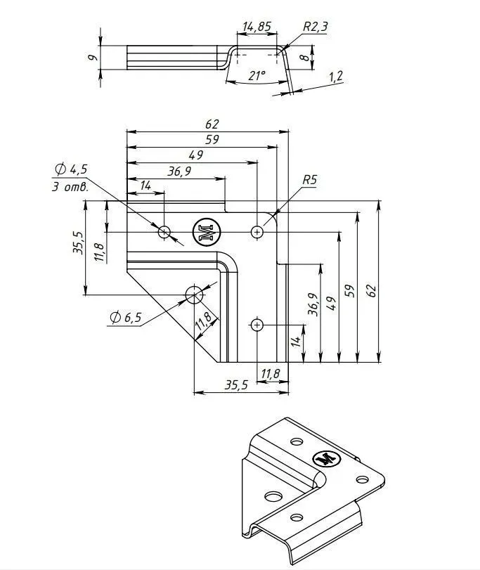

# Повторное устранение замечаний по первоначальной версии модели 

Повторно доработать модель после первой доработки согласно замечаниям.

С учетом замечаний ниже сделать.

- 3D модель в установленном формате 
- эскиз в 3 проекциях: вид сбоку и вид слева
- трёхмерное изображение конструкции.
- спецификацию деталей
 
## Замечания по конструкции

### Крепление подшипников в балках

Полукруглая выемка под подшипники сделана по всей глубине средней поперечины и 
балки фмксации подшипника. Это неправильно. Это пожет привести к перемещению
подшипника в соосном направлении и вападении. 

Полукруглую выемку стоит сделать только на глубину подшипника и в центральной
части балок и поперечен. Чтобы он был зафиксирован не только в радиальном, но и
осевом положении.

### Фиксация подшипников на валу

Вал не фиксируется в подшипниках, из за чего испытывает осевое смещение и 
кулачковый диск может сместиться относительно ролики и даже вылететь несмотря на
ложбинку. Необходимо зафиксировать положение вала в подшипниках, прижав с обоих
сторон каждого подшипника коническими гайками и законтрив ещё одной гайкой.

### Расположение краб-систем

Краб-система должна фиксировать балку таким образом, чтобы не занимать
пространство над ней во избежание соприкосновения с вибрирующим столом или
линейным подшипником. Поэтому одна часть угла должна быть направлена вдоль
балки, а другая вниз, а не вверх.

Кроме того на можель изображено крепление уголками, а не краб-системой.
Краб-система = это две пластины на каждое соединение, которые обжимают профиль
трубы с двух сторон через болты и гайки. Дополнительно фиксируются, прикручиваясь 
непосредственно к профилю черед другие отверстия. Форма и размеры пластин изображены на
рисунке 

### Располодение подстолья

Подстолье расположено под выступающим краем стола и может служить препятствием 
для перемещения стола или линейных подшипников.

Необходимо развернуть его на 90 градусов и сместить к заднему торцу в ровень  с
окончанием рамы. Получится, что подстолье будет занимать всю ширину рамы, но не
будет доходить до чтола и не будет создавать ему препятствий.
А болты крепления будут проходить через верхнии балки рамы в части выноса.

Так же становится не нудна дополнительная балка под болты, так как болты будут 
проходить непосредственно через раму. Выступы мз рамы на заднем торце под болты 
крепления так же нужно убрать

## Результаты этапа

- Отчёт: [Report.md](./Report.md)
- Вопросы и принятые решения: [Interview.md](./Interview.md)
- 3D-модель: [cad/step/vibrotable_assembly.step](./cad/step/vibrotable_assembly.step),
  детали — `cad/step/*.step`; исходники — [cad/](./cad/) (`model.py`,
  `params.py`, `build.py`, `draw_sheet.py`, `export_groups.py`,
  `render_views.py`)
- Печатные детали: [cad/stl/](./cad/stl/) (`frame.stl`, `table.stl`,
  `overlay.stl`, `podstol.stl`, `retainer.stl`, `cam_3/5/10.stl`);
  параметры печати — [cad/print.csv](./cad/print.csv)
- Эскиз в трёх проекциях (A3, HLR): [fig/vibrotable_views.svg](./fig/vibrotable_views.svg);
  изометрия — [fig/iso.svg](./fig/iso.svg)
- Спецификация и параметры: [fig/vibrotable_spec.svg](./fig/vibrotable_spec.svg),
  [spec.csv](./spec.csv), [params.csv](./params.csv),
  [cad/checks.csv](./cad/checks.csv), [cad/mass.csv](./cad/mass.csv)
- Рендеры: [pic/](./pic/) (`render_iso.png`, `render_iso_rear.png`,
  `render_left.png`, `render_top.png`, `render_front.png`,
  `render_mechanism.png`, `render_clamp.png`, `render_crab.png`,
  `render_bearing_pocket.png`, `render_shaft_nuts.png`,
  `render_podstol.png`, `render_retainer_down.png`);
  превью листов — `views_sheet.png`, `spec_sheet.png`, `iso_sheet.png`